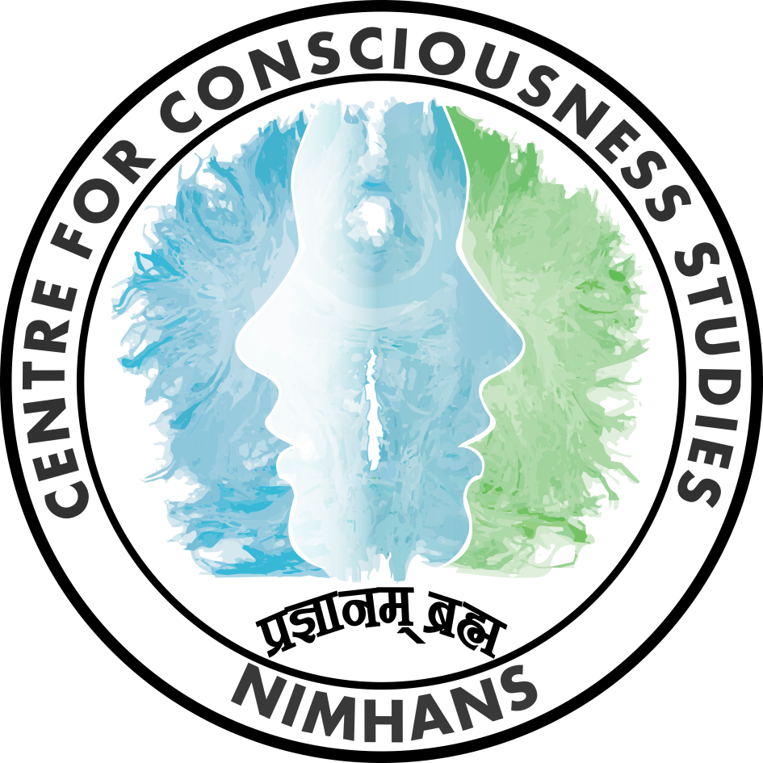

<p align="center">
  
</p>

<h1 align="center">CCS fMRI Studio</h1>

<p align="center">
  <b>Cross-platform desktop fMRI preprocessing, native-speed Rust denoising, parcellation, and EEG-style timeseries/connectivity workbench</b>
</p>

<p align="center">
  A Research &amp; Engineering Collaboration of<br>
  <b>Centre for Consciousness Studies (CCS)</b>, Department of Neurophysiology,<br>
  <b>National Institute of Mental Health and Neurosciences (NIMHANS)</b>, Bengaluru, India
</p>

<p align="center">
  <a href="https://github.com/CCS-NIMHANS/CCS_fMRIStudio/releases/latest"></a>
  <a href="https://github.com/CCS-NIMHANS/CCS_fMRIStudio/actions/workflows/build.yml"></a>
  <a href="https://github.com/CCS-NIMHANS/CCS_fMRIStudio/releases"></a>
  <a href="LICENSE"></a>
</p>

<p align="center">
  <b>Current version: 0.5.0</b> ·
  <a href="docs/wiki/Home.md"><b>Visual Wiki</b></a> ·
  <a href="CHANGELOG.md"><b>Release Notes</b></a> ·
  <a href="docs/wiki/Benchmarks-and-Validation.md"><b>Benchmarks &amp; Validation</b></a> ·
  <a href="docs/wiki/Building-and-Releasing.md"><b>3-OS Build Guide</b></a> ·
  <a href="CODE_SIGNING_POLICY.md"><b>Code Signing Policy</b></a> ·
  <a href="https://github.com/CCS-NIMHANS/CCS_fMRIStudio/issues"><b>Report Issue</b></a>
</p>

> ### 📄 [v0.5.0 Validation Report](docs/validation/v0.5.0/REPORT.md) · [PDF](docs/validation/v0.5.0/REPORT.pdf)
> CCS fMRI Studio v0.5.0 benchmarked against **fMRIPrep 24.1.1** (preprocessing) and **nilearn 0.14** (time series & connectivity) on 25 runs from OpenNeuro ds003768 (EEG-fMRI sleep) and ds006110 (PsiConnect psilocybin), including concordance of **sleep-stage** and **psilocybin / naturalistic-condition** effects.
>
> | Tier | Key result |
> | :--- | :--- |
> | Preprocessing vs fMRIPrep | brain-mask Dice **0.987**; FD r **0.81** |
> | Engine vs nilearn (identical inputs) | ROI extraction identical (19 ms vs 4.1 s); denoising identical given the same model (34/37 runs); FC r **0.95** vs nilearn default filter |
> | End-to-end vs fMRIPrep + nilearn | FC r **0.68**, network level **0.87**; same-run agreement (0.60) exceeds either pipeline's test-retest (0.46 / 0.54) |
> | Biological concordance | sleep: BOLD amplitude ↑ in 3/3 subjects with both pipelines, ΔFC r **0.63**; psilocybin: within-network FC ↓ in 4/4 conditions, ΔFC r **0.88–0.94** |
> | Speed | preprocessing **80–90 s / run** vs fMRIPrep ≈ 60 min / subject |

---

## 📥 Quick Download

| Platform | Package | Direct Download |
| :--- | :--- | :--- |
| **macOS** | Apple Developer ID signed &amp; notarized DMG / App ZIP (macOS 12+) | [CCSfMRIStudio-macos.dmg](https://github.com/CCS-NIMHANS/CCS_fMRIStudio/releases/latest/download/CCSfMRIStudio-macos.dmg) · [CCSfMRIStudio-macos.zip](https://github.com/CCS-NIMHANS/CCS_fMRIStudio/releases/latest/download/CCSfMRIStudio-macos.zip) |
| **Windows** | 64-bit Portable Desktop ZIP / MSIX (Windows 10/11) | [CCSfMRIStudio-windows-x64.zip](https://github.com/CCS-NIMHANS/CCS_fMRIStudio/releases/latest/download/CCSfMRIStudio-windows-x64.zip) · [CCSfMRIStudio-windows-x64.msix](https://github.com/CCS-NIMHANS/CCS_fMRIStudio/releases/latest/download/CCSfMRIStudio-windows-x64.msix) |
| **Linux (x86_64)** | Portable Desktop Bundle (`.tar.gz`) | [CCSfMRIStudio-linux-x64.tar.gz](https://github.com/CCS-NIMHANS/CCS_fMRIStudio/releases/latest/download/CCSfMRIStudio-linux-x64.tar.gz) |

> 📦 Checksums (`SHA256SUMS.txt`) and release assets are published on the **[GitHub Releases Page](https://github.com/CCS-NIMHANS/CCS_fMRIStudio/releases/latest)**.
> 🔐 Free Windows code signing provided by [SignPath.io](https://signpath.io/), certificate by [SignPath Foundation](https://signpath.org/) (see [Code Signing Policy](CODE_SIGNING_POLICY.md)).

<details>
<summary><b>🍏 macOS Setup &amp; 🐧 Linux Bundle Launch</b></summary>

**macOS:** Official CI releases are Apple Developer ID signed and notarized — open the `.dmg` and drag **CCS fMRI Studio** to `/Applications` (no terminal command needed). Only for local or ad-hoc unsigned builds, clear the quarantine flag first:
```sh
xattr -rd com.apple.quarantine ~/Downloads/ccs_fmri_studio.app
mv ~/Downloads/ccs_fmri_studio.app /Applications/
```

**Linux (portable bundle):**
```bash
mkdir -p ~/CCS_fMRIStudio && tar -xzf ~/Downloads/CCSfMRIStudio-linux-x64.tar.gz -C ~/CCS_fMRIStudio
~/CCS_fMRIStudio/ccs_fmri_studio
```

</details>

---

## ✨ What's New in v0.5.0 (validity release)

v0.5.0 fixes preprocessing and statistics problems found in an independent review and benchmark against
**fMRIPrep 24.1.1 + nilearn** (see [`CHANGELOG.md`](CHANGELOG.md) and the validation report). **Re-run preprocessing for data
processed with ≤ 0.4.1.**

- **Brain extraction + correct normalisation:** template-based skull stripping (head-to-head SyN, back-projected brain
  mask) and brain-to-brain SyN to **MNI152NLin6Asym**, the native space of the bundled Schaefer-2018 atlas.
- **Valid aCompCor masks:** Atropos on the skull-stripped brain; eroded deep-WM and ventricular-CSF masks.
- **Slice-timing correction**, **true single-interpolation** resampling (motion ∘ coregistration ∘ normalisation per volume),
  **quality-controlled motion estimation**, fixed random seeds, disk-space and output validation (runs fail loudly instead of
  writing corrupt confounds).
- **Censoring done right:** censored frames are excluded from every statistic; default model is simultaneous
  nuisance + DCT band-pass + spike regression (equivalent to AFNI `3dTproject -cenmode KILL`); residual DOF reported honestly
  with warnings.
- **Statistics fixes:** Newman modularity formula, positive-weight graphs, seed maps with matched cleaning and DOF-based z.
- **Per-subject `qc_report.html`** (fMRIPrep-style): alignment overlays, tissue masks, motion/FD/DVARS, carpet plot,
  parcel coverage and an auto-generated methods paragraph.
- **Publication figures in the app:** a *Generate Publication Figures* button (Summary & Export) and a *Group Publication
  Figures* button (Stats → Group) write report-style 300-dpi PNG + SVG figures for a subject or a session/condition contrast.

<details>
<summary>Previous Releases: v0.4.1, v0.4.0, v0.3.0, v0.2.0, v0.1.3, v0.1.2, v0.1.1 &amp; v0.1.0</summary>

**v0.4.1**
- **Nilearn Seed-to-Voxel GLM Voxelwise Denoising:** Updated `--mode seed-glm` (`nilearn_stats.py` / `results_dashboard.dart`) to accept `--confounds-tsv`, `--low-hz`, `--high-hz`, and `--tr`, regressing motion confounds and applying matching bandpass filtering inside `NiftiMasker` before Fisher-$z$ correlation.

**v0.4.0**
- **Linear-Interpolation Censoring & Effective DOF QC (`CensorMode::Interpolate`):** Replaces low-DOF flat-zero spike plateaus on high-motion scans with Power et al. (2014) intact-frame nuisance regression + linear interpolation before bandpass filtering, reports **Effective DOF remaining** and **Motion QC warnings**, and uses robust MAD scaling for Raw vs Clean BOLD traces.
- **Pure-Rust Graph Theory Tab (`Graph Theory`):** Computes NaN-safe Weighted & Binary Global/Local Efficiency, Onnela Clustering ($C$), Path Length ($L$), Maslov-Sneppen Small-Worldness ($\sigma$), Newman Modularity ($Q$), Assortativity ($r$), Brandes Betweenness, Participation Coefficient ($P_i$), Within-Module $z_i$, **Density Sweep (5%–40%)**, and **Hub Classification Scatter ($P_i$ vs $z_i$)**, exporting `graph_metrics_nodal.csv` and `graph_metrics_global.json`.
- **Advanced Nilearn Statistical Inference (`Stats (Nilearn)`):** Runs **Single-Subject Seed-to-Voxel GLM** (BH-FDR / Bonferroni thresholding, MNI cluster tables, and inline `plot_glass_brain` / `plot_stat_map` figures) plus **Group / Batch Connectivity Statistics** (edgewise FDR $t$-tests, NBS permutation clusters, Tangent-Space CV decoding, and `statsmodels.MixedLM`).
- **Net Directed Transfer Entropy & Zoomed ANOVA Dynamics:** Adds **Net Flow (`TE i→j − TE j→i`)** toggle with mid-arc directional chevrons + **Sender vs Receiver** diverging bar chart, plus zoomed Y-axis scaling and Yeo-7 One-Way ANOVA (`F`, `p`) across intrinsic timescales and complexity.

**v0.3.0**
- **Interactive Batch Analysis (`6. Batch`):** Scan a whole study root folder (`Patient_*/pre|post` or BIDS), add individual folders, or multi-select NIfTI/DICOM files into a searchable subject queue with checkboxes and per-subject file editors.
- **Full End-to-End Batch Pipeline & Group Export:** Toggle DICOM conversion, `ANTsPy` preprocessing (`Skip Existing Preproc`), Rust denoising + Pearson/Partial/GCMI/TE connectivity, and timeseries dynamics (`ACW`, `LZC`, `SampEn`, `PLE`), with live progress, safe cancellation, 1-click single-subject inspection, and incremental `batch_summary.csv` + `batch_summary.json` export.

**v0.2.0**
- **CONN-Style Denoising Quality Control:** Visualize before-vs-after FC bell curves, Framewise Displacement motion traces with scrubbed spikes, Welch Power Spectral Density filtering, and Raw vs Clean BOLD Carpet Plots side-by-side.
- **Interactive ROI Timeseries Explorer:** Filter/search parcels by Yeo-7 network & hemisphere, inspect multi-ROI raw-vs-clean traces, `%` nuisance variance removed, and pairwise multi-measure coupling.
- **Nilearn Partial FC + GCMI + Directed Transfer Entropy & Circular Connectome:** Analytical Ledoit-Wolf shrinkage partial correlation, Gaussian-copula Mutual Information (GCMI), directed Transfer Entropy (`CCS_EEGStudio`-inspired), clickable ROI × ROI heatmaps, directional circular connectome, and Top-10 Hub ROIs.
- **fMRI Timeseries Dynamics (`fMRIAnalysis.py` Pure-Rust Engine):** Rayon-parallel sliding-window `ACW-0`, `ACW-50`, `ACF AUC`, `LZC`, `Sample Entropy`, `Median Frequency`, `Spectral Entropy`, and `1/f PLE` across Slow-5/Slow-4 sub-bands with Yeo-7 network profiles and `roi_dynamics.csv` export.

**v0.1.3**
- **Whole-Pipeline Progress Bar & Visual 8-Stage ANTsPy Tracker:** Persistent 5-step top progress header (`1. Import` → `2. Preprocess` → `3. Lesion (Opt)` → `4. Denoise` → `5. Results`), live elapsed timer (`MM:SS`) + progress bar, and an 8-stage visual milestone grid during `ANTsPy` preprocessing with a green **Continue to Step 4 →** CTA upon completion.
- **Step 5 Visual Results & Auto-Export Dashboard:** Automatically saves `fc_matrix.csv`, `denoised_timeseries.csv`, `biomarkers_summary.json`, and `clinical_report.md`, and displays **KPI Biomarker Cards**, a **400×400 Functional Connectivity Heatmap**, a **Denoised ROI Timeseries Carpet Plot**, and one-click **Open Results Folder** / **Save Clinical Report As…** / **Analyze Another Patient** actions.
- **Clean Step 4 & Full-Size Brain Slice Viewport:** Compact basename chips, explicit **Apply Lesion Mask** switch, clearly labeled sliders, collapsible manual paths, and a dark-framed scaled slice viewport.

**v0.1.2**
- **Smart 1-Click Patient Folder Detection (DICOM `.IMA`/`.dcm`, NIfTI, BIDS, or Preprocessed):** Click **Open Patient Folder** on any subject directory — including raw Siemens `.IMA` multi-series folders — and CCS fMRI Studio automatically identifies the best T1w isotropic and 4D BOLD series, raw NIfTIs, or `preproc/` MNI derivatives and shows you the exact next button to click.
- **Zero-Jargon Guided Onboarding + Friendly `.IMA` Handling:** Picking an individual `.IMA`/`.dcm` slice automatically switches to patient-folder DICOM conversion instead of throwing a NIfTI header error, while manual path fields and header inspection stay neatly tucked inside an **Advanced** panel.
- **Bundled Sidecar & Templates Inside Release Apps:** Packaged macOS/Windows/Linux releases bundle `python_sidecar/` and `assets/templates/registry.json` directly inside the app and auto-extract on first sidecar run.

**v0.1.1**
- **Interactive Native File & Folder Pickers + Auto-Detection:** Every path field now has a native OS **Browse** picker (`file_picker`), plus 1-click **Open Folder** auto-discovery.
- **Guided 4-Step Clinical Workflow:** Intuitive sidebar (`1. Import` → `2. Preprocess` → `3. Lesion` → `4. Denoise`) wired directly to DICOM-to-BIDS conversion, lesion-safe `ANTsPy` preprocessing, interactive 3D lesion segmentation/editing, and Rust slice/timepoint visualization & denoising.
- **In-App GitHub Releases Updater:** Built-in **Updates** dialog checks `CCS-NIMHANS/CCS_fMRIStudio` Releases, verifies `SHA256SUMS.txt`, and supports one-click macOS `.app` update & relaunch (plus Windows/Linux bundle download & reveal), matching `CCS_EEGStudio`.

**v0.1.0**
- **Hybrid Flutter + Rust Core + Embedded Python Sidecar:** Cross-platform desktop UI bridged over zero-copy `flutter_rust_bridge` v2 (`libccs_fmri_core`) alongside a relocatable `uv`-managed Python scientific sidecar (`antspyx`, `nilearn`, `nibabel`, `scikit-learn`, `statsmodels`) — bypassing WSL, Docker, FSL, and AFNI dependencies.
- **Zero-Copy Memory-Mapped NIfTI & 60/120 FPS RGBA Slice Rendering:** Direct `memmap2` Fortran-order mapping for uncompressed native `f32` 4D volumes (`.nii`) plus `.nii.gz` fallback, BIDS `.json` sidecar `RepetitionTime` auto-detection, and 2nd–98th percentile orthogonal RGBA slice rendering.
- **Native-Speed Parcellation, CONN-Style aCompCor & Simultaneous Denoising:** Parallel Rayon Schaefer-400 extraction (`28.20 ms` median), WM/CSF aCompCor PCA via `faer` thin SVD, and single-step orthogonalized DCT-II stopband bandpass + motion + FD scrubbing projection (`r > 0.99999999999` parity vs. `nilearn` cosine filtering).
- **ANTsPy Single-Subject Preprocessing CLI:** Automated DICOM-to-BIDS conversion (`dcm2niix`), N4 bias correction, Atropos 3-class WM/CSF tissue segmentation, `antsRegistrationSyNQuick[s]` MNI152 2 mm registration, 4D rigid motion correction + Power FD `confounds.tsv`, and single-interpolation 4D MNI warp in **101.93 s** (~1.7 min) on a 24 GB MacBook Pro.
- **TBI & Stroke Clinical Lesion Modules:** Auto-segment + 3D Magic Wand manual lesion editor, Cost Function Masking / Enantiomorphic contralesional healing, clinical templates, lesion-aware connectivity biomarkers, and `statsmodels` group LMM.

</details>

---

## 🏗️ Hybrid System Architecture

```
┌─────────────────────────────────────────────────────────────────┐
│                  FLUTTER / DART FRONTEND (UI)                   │
│  • NIfTI Header & BIDS Sidecar Inspector                        │
│  • Zero-Copy RGBA Ortho Slice Viewport (ui.decodeImageFromPixels│
│  • Native Rust Denoising & Functional Connectivity Workbench    │
└───────────────────────────────┬─────────────────────────────────┘
                                │ flutter_rust_bridge v2 (FFI)
┌───────────────────────────────▼─────────────────────────────────┐
│                   RUST CORE ENGINE (rust/)                      │
│  • Zero-copy memmap2 `.nii` loader + `nifti` `.nii.gz` fallback │
│  • Parallel Rayon Schaefer-400 parcellation extraction          │
│  • CONN-style WM/CSF aCompCor & simultaneous DCT bandpass +     │
│    nuisance + FD scrubbing projection via `faer` thin SVD       │
│  • Static Pearson FC & sliding-window dynamic FC                │
└───────────────────────────────┬─────────────────────────────────┘
                                │ uv-managed sidecar (CLI / IPC)
┌───────────────────────────────▼─────────────────────────────────┐
│            EMBEDDED PYTHON SIDECAR (python_sidecar/)            │
│  • Siemens DICOM -> NIfTI + BIDS JSON (`dcm2niix`)              │
│  • ANTsPy (`antspyx`): N4, Atropos, SyNQuick MNI, Rigid MoCo    │
│  • Nilearn / scikit-learn / statsmodels Analytical Parity       │
└─────────────────────────────────────────────────────────────────┘
```

---

## ⚡ Verified Speedup & Parity Benchmarks

> Accuracy validation for v0.5.0 is in the [**v0.5.0 Validation Report**](docs/validation/v0.5.0/REPORT.md). The Rust-core timings below were measured with v0.4.x on the same Rust engine; the ANTsPy preprocessing timing is for v0.5.0.

Evaluated on clinical 3T resting-state fMRI + T1w DICOM data (`Patient_01/pre`, `99 × 117 × 95 × 450` float32 MNI152 2 mm volume, ~1.98 GB uncompressed, 400 Schaefer ROIs, 22 motion + WM/CSF aCompCor confounds, 98 `FD > 0.5 mm` scrubbing frames, `0.008–0.09 Hz` bandpass, 400×400 FC) over **3 repeated trials** on Apple Silicon (24 GB RAM):

| Pipeline / Metric | Rust `.nii` (`memmap2`) | `nilearn` `.nii` | Rust `.nii.gz` | `nilearn` `.nii.gz` | Speedup (`.nii` `mmap` / `.nii.gz`) |
| :--- | ---: | ---: | ---: | ---: | ---: |
| **Load** | 3.32 ms | 2.19 ms | 3,234.20 ms | 2.31 ms | — |
| **Schaefer-400 Parcellation** | **28.20 ms** | 4,453.02 ms | **16.94 ms** | 12,189.47 ms | **157.91×** / **719.57×** |
| **WM + CSF aCompCor (5+5)** | **604.65 ms** | 4,620.74 ms | **622.72 ms** | 14,384.53 ms | **7.64×** / **23.10×** |
| **Simultaneous Denoising** | **32.56 ms** | 51.27 ms | **33.09 ms** | 50.74 ms | **1.57×** / **1.53×** |
| **400×400 Pearson FC** | 2.81 ms | 0.56 ms | 2.89 ms | 0.57 ms | — |
| **Total End-to-End (Median)** | **670.55 ms** | **9,161.38 ms** | **3,883.26 ms** | **26,628.17 ms** | **13.66×** / **6.86×** |
| **Peak RSS Memory** | **2,244.58 MB** | 4,105.03 MB | 4,574.94 MB | 4,119.31 MB | **1.83× less RAM** (`.nii`) |

- **Mathematical Parity (`400` Schaefer ROIs)**:
  - Rust simultaneous denoising vs. `nilearn.signal.clean` given the identical design (confounds + DCT basis + censoring): identical in 34/37 runs (FC r = 1.000, max |Δ| ≤ 3·10⁻⁶; v0.5.0 report).
  - Rust DCT band-pass (`0.008–0.09 Hz`) vs. `nilearn` Butterworth: median FC **r = 0.95** (runs with ≥ 30 residual DOF; v0.5.0 report).
- **ANTsPy Preprocessing (`SyNQuick`, v0.5.0)**: full structural + functional pipeline (brain extraction, segmentation, SyN, slice timing, QC'd motion, one-shot resampling, QC report) in **80–90 s** for 286–504-volume runs on an idle 14-core Apple Silicon Mac (v0.4.1: 98–130 s), peak RSS 5–7 GB. External validation against fMRIPrep 24.1.1 + nilearn: brain-mask Dice 0.987, FD r 0.81, same-run FC agreement 0.60 (above both pipelines' run-to-run reliability, 0.46/0.54).

---

## 📖 Visual Wiki Guides

| Guide | Topics Covered |
| :--- | :--- |
| [**Wiki Home**](docs/wiki/Home.md) | End-to-end workflow map, supported formats, and project navigation |
| [**1. Architecture & Hybrid Engine**](docs/wiki/Architecture-and-Hybrid-Engine.md) | Flutter + `flutter_rust_bridge` v2 + `memmap2` + `faer` + `uv` sidecar & 24 GB RAM safeguards |
| [**2. Preprocessing & DICOM / BIDS**](docs/wiki/Preprocessing-and-DICOM-BIDS.md) | `dcm2niix` Siemens `.IMA` conversion, ANTsPy N4/Atropos/SyNQuick/MoCo, and `confounds.tsv` |
| [**3. Rust Denoising & Connectivity**](docs/wiki/Rust-Denoising-and-Connectivity.md) | Schaefer parcellation, aCompCor, simultaneous orthogonalized DCT projection, FC/dFC, RGBA slices |
| [**4. Benchmarks & Validation**](docs/wiki/Benchmarks-and-Validation.md) | **v0.5.0 validation vs fMRIPrep / nilearn** (incl. sleep & psilocybin concordance), runtime, and Rust-vs-nilearn speed benchmarks |
| [**5. Building & Releasing (3 OSes)**](docs/wiki/Building-and-Releasing.md) | Local builds, `flutter_rust_bridge_codegen`, and 3-OS GitHub Actions release packaging |
| [**6. TBI & Stroke Lesion Workflows**](docs/wiki/TBI-and-Stroke-Lesion-Workflows.md) | Auto-segmentation, Flutter 3D mask editor, CFM/Enantiomorphic registration, clinical templates & LMM |

---

## 🚀 Building & Testing Locally

**Prerequisites:** Flutter SDK (`3.41.x`), Rust toolchain (`cargo` / `rustc`), `uv`, and `dcm2niix`.

```bash
# 1. Build and test the native Rust core engine
cargo test --release --locked --manifest-path rust/Cargo.toml
cargo build --release --locked --manifest-path rust/Cargo.toml

# 2. Set up the uv Python sidecar
cd python_sidecar && uv sync && cd ..

# 3. Analyze, test, and run the Flutter desktop app
flutter pub get
flutter analyze
flutter test
flutter run -d macos   # or windows / linux
```

<details>
<summary><b>🧪 Running End-to-End Preprocessing & Rust-vs-Nilearn Benchmarks</b></summary>

```bash
cd python_sidecar

# Convert raw T1w + 4D BOLD DICOM folders to NIfTI + BIDS JSON
uv run python -m ccs_fmri_sidecar.dicom_convert \
  --t1-dicom <T1_DICOM_DIR> \
  --bold-dicom <BOLD_DICOM_DIR> \
  --out ../data_test_output/subject/raw

# Preprocess with ANTsPy (N4, Atropos, SyNQuick MNI152 2mm, 4D MoCo)
uv run python -m ccs_fmri_sidecar.preprocess \
  --t1 ../data_test_output/subject/raw/t1w.nii.gz \
  --bold ../data_test_output/subject/raw/bold.nii.gz \
  --out ../data_test_output/subject/preproc \
  --transform SyNQuick

# Benchmark Rust vs. nilearn across 3 repeated trials
uv run python -m ccs_fmri_sidecar.benchmark_vs_nilearn \
  --preproc-dir ../data_test_output/subject/preproc \
  --bench-bin ../rust/target/release/bench_denoise \
  --repeats 3 \
  --out-json ../data_test_output/subject/benchmark_verified.json
```

</details>

---

## 📚 Method References

| Category | App Method | Paper or Reference | Implementation Scope |
| :--- | :--- | :--- | :--- |
| **DICOM / BIDS** | Mosaic CSA & BIDS sidecar extraction | Li et al. (2016), [doi:10.1016/j.jneumeth.2016.03.001](https://doi.org/10.1016/j.jneumeth.2016.03.001) | Automated `dcm2niix` wrapper extracting `RepetitionTime` and `SliceTiming`. |
| **Structural** | N4, template-based brain extraction & Atropos | Tustison et al. (2010), [doi:10.1109/TMI.2010.2046908](https://doi.org/10.1109/TMI.2010.2046908); Avants et al. (2011), [doi:10.1007/s12021-011-9109-y](https://doi.org/10.1007/s12021-011-9109-y) | Skull stripping by SyN to MNI152NLin6Asym (head) + back-projected brain mask; 3-class Atropos on the winsorised brain; eroded WM (P>0.9) and ventricular CSF (P>0.9) masks for aCompCor. |
| **Registration** | SyN Diffeomorphic Normalization | Avants et al. (2008), [doi:10.1016/j.media.2007.06.004](https://doi.org/10.1016/j.media.2007.06.004) | Brain-to-brain `antsRegistrationSyNQuick[s]` to MNI152NLin6Asym (TemplateFlow); BOLD→T1w rigid; motion, coregistration and normalisation composed into one interpolation onto the 2 mm grid. |
| **Slice timing / Motion & QC** | Fourier slice-timing correction; FD | Power et al. (2012), [doi:10.1016/j.neuroimage.2011.10.018](https://doi.org/10.1016/j.neuroimage.2011.10.018) | STC to mid-TR from BIDS `SliceTiming`; per-volume rigid registration with quality control; Power FD (50 mm sphere); `qc_report.html` per run. |
| **Denoising** | aCompCor & Simultaneous Projection | Behzadi et al. (2007), [doi:10.1016/j.neuroimage.2007.04.042](https://doi.org/10.1016/j.neuroimage.2007.04.042); Hallquist et al. (2013), [doi:10.1016/j.neuroimage.2013.05.116](https://doi.org/10.1016/j.neuroimage.2013.05.116); Lindquist et al. (2019), [doi:10.1002/hbm.24528](https://doi.org/10.1002/hbm.24528); Power et al. (2014), [doi:10.1016/j.neuroimage.2013.08.048](https://doi.org/10.1016/j.neuroimage.2013.08.048) | Native Rust `faer` projection of confounds, high-passed aCompCor, DCT-II stopband and censored-frame spikes in one model (= `3dTproject -cenmode KILL`); censored frames excluded from all statistics; DOF = retained frames − design rank. |
| **Parcellation** | Schaefer 400-Parcel 7-Network Atlas | Schaefer et al. (2018), [doi:10.1093/cercor/bhx179](https://doi.org/10.1093/cercor/bhx179) | Atlas used in its native FSL MNI152 (NLin6Asym) 2 mm grid (no resampling); per-parcel EPI coverage reported; parallel Rayon mean ROI extraction. |

---

## 🤝 Acknowledgments, Related Projects & Citation

- **Research Group:** **Centre for Consciousness Studies (CCS)**, Dept. of Neurophysiology, **NIMHANS**, Bengaluru, India.
- **Related Repositories:** [CCS EEG Studio](https://github.com/CCS-NIMHANS/CCS_EEGStudio) · [CCS Sleep Studio](https://github.com/CCS-NIMHANS/CCS_SleepStudio) · [CCS Mobile Studio](https://github.com/CCS-NIMHANS/CCS_MobileStudio) · [CCS PPG Studio](https://github.com/CCS-NIMHANS/CCS_PPGStudio)
- **License:** [MIT License](LICENSE) © 2026 Dr. Arun Sasidharan, Centre for Consciousness Studies, NIMHANS.

```bibtex
@software{Sasidharan2026CCSfMRIStudio,
  author    = {Arun Sasidharan},
  title     = {{CCS fMRI Studio}: Cross-platform desktop fMRI preprocessing, native Rust denoising, and connectivity workbench},
  year      = {2026},
  publisher = {Centre for Consciousness Studies, NIMHANS},
  url       = {https://github.com/CCS-NIMHANS/CCS_fMRIStudio}
}
```
