# CCS fMRI Studio: validation of a native-speed resting-state fMRI pipeline against fMRIPrep and nilearn, with concordance of sleep- and psilocybin-related brain changes

**Validation report, CCS fMRI Studio v0.5.0** · Centre for Consciousness Studies, NIMHANS · 28 November 2026

---

## Abstract

**Background.** CCS fMRI Studio is a desktop application for single-subject resting-state and naturalistic fMRI. It combines ANTsPy-based preprocessing, a Rust time-series/connectivity engine and an embedded nilearn sidecar. Here we benchmark v0.5.0 against community gold standards.

**Methods.** Benchmarks used 25 runs from two OpenNeuro datasets: ds003768, simultaneous EEG-fMRI with 30-s sleep scoring (7 subjects), and ds006110 PsiConnect, before and after 19 mg psilocybin in rest, movie, music and meditation conditions. Validation had four tiers:

1. **Preprocessing** vs fMRIPrep 24.1.1.
2. **Time-series and connectivity engine** vs nilearn 0.14 on identical inputs.
3. **End-to-end** vs fMRIPrep + nilearn, including before/after denoising QC, test-retest framing and seed maps.
4. **Biological concordance:** whether the app reproduces sleep-stage and psilocybin/condition effects found by the reference pipelines.

**Results.**
- **Preprocessing.** Brain masks matched fMRIPrep (Dice 0.987, range 0.985–0.989). Framewise displacement (FD) correlated r = 0.81 per volume, but the app's FD was ~27 % higher.
- **Engine.** The Rust engine reproduced nilearn's ROI extraction exactly (min r > 0.99999999). It also reproduced denoising given the same design (34/37 runs identical to < 3·10⁻⁶; three differed only in near-singular designs with ≤ 20 residual DOF). Against nilearn's default Butterworth filtering, FC agreement was r = 0.95 (median, DOF ≥ 30).
- **End-to-end.** FC agreed with fMRIPrep + nilearn at r = 0.68 (DOF ≥ 30) and Yeo-7 network-level r = 0.87. Network segregation was identical (within−between z 0.252 vs 0.251). Same-run cross-pipeline similarity (0.60) exceeded each pipeline's own run-to-run reliability (app 0.46, reference 0.54).
- **Sleep.** In 3 of 3 subjects, both pipelines showed higher BOLD fluctuation amplitude in N1/N2 than in wake. Edge-wise sleep-related FC changes agreed at r = 0.63 (subject range 0.54–0.72).
- **Psilocybin.** Both engines showed reduced within-network FC after psilocybin in all four conditions, consistent with network desegregation. Edge-wise post−pre changes agreed at r = 0.88–0.94.
- **Speed.** Preprocessing took 80–90 s per run, against ≈60 min per subject for fMRIPrep in our setting.

**Conclusion.** v0.5.0 reproduces gold-standard connectivity and biologically salient FC changes within the bounds of run-to-run variability, about 40× faster. The main remaining differences are a higher FD estimate (hence more censoring) and DOF limits in short-TR, high-motion runs; the app now reports both explicitly. A planned AFNI (`3dROIstats`/`3dTproject`) benchmark and a multi-site sample are left for a Linux server.

---

## 1. Introduction

Single-subject FC is increasingly used clinically and in state-dependent studies such as sleep and psychedelics. There it matters that a fast, installable tool produces the *same* answers as accepted pipelines. The state of the art is:

- **Preprocessing:** fMRIPrep (Esteban et al., 2019).
- **Confound regression, filtering and connectivity:** nilearn (Abraham et al., 2014) and AFNI `3dTproject` (Cox, 1996), with censoring (Power et al., 2014; Ciric et al., 2017).

We therefore benchmarked each part of CCS fMRI Studio against the matching gold standard. We then asked the question that matters for users: does the app recover the same biological effects?

## 2. Methods

### 2.1 Software under test (CCS fMRI Studio v0.5.0)

| Stage | Implementation |
|---|---|
| Structural | N4; template-based brain extraction (head-to-head SyN to MNI152NLin6Asym, back-projected brain mask); Atropos 3-class on the winsorised brain; brain-to-brain SyNQuick |
| Functional | Fourier slice-timing correction (mid-TR); per-volume rigid motion estimation with quality control; BOLD→T1w rigid; **one interpolation** per volume onto the 2 mm MNI152NLin6Asym grid; inputs verified against nibabel |
| Parcellation | Schaefer-400, 7 networks, in its native FSL MNI152 grid |
| Denoising (Rust) | 12 motion parameters + derivatives, 5 WM + 5 CSF aCompCor (DCT high-passed), DCT band-pass 0.008–0.09 Hz and one regressor per FD > 0.5 mm frame, fitted simultaneously (= AFNI `3dTproject -cenmode KILL`); censored frames excluded from all statistics; DOF = retained frames − design rank |
| Outputs | Pearson / partial / GCMI / TE connectomes, graph metrics, dynamics (ACW, LZC, SampEn, PLE), seed maps (DOF-based z), per-run `qc_report.html` |

### 2.2 Data

| Dataset | Subjects / runs | TR / volumes | Labels used |
|---|---|---|---|
| ds003768 (Gu et al.; EEG-fMRI, Siemens Prisma) | sub-01: 2 rest + 3 sleep runs; sub-02…07: 2 rest runs each | 2.1 s / 286–429 | Official 30-s sleep scoring (W, N1, N2) |
| ds006110 PsiConnect (Novelli et al., 2026; MB4, one echo) | sub-PC001: pre and post 19 mg psilocybin × rest, movie, music, meditation | 0.91 s / 372–729 | Session, condition |

### 2.3 Reference pipelines

- **Preprocessing reference:** fMRIPrep 24.1.1 (`--fs-no-reconall`, MNI152NLin6Asym 2 mm, seed 42). Available for 14 runs (all 12 external rest runs, ds003768 sub-01 rest-1 and PsiConnect pre-rest). Further fMRIPrep runs were deliberately not performed on the laptop (≈1 h per subject under emulation).
- **Connectivity reference:** nilearn 0.14 `NiftiLabelsMasker` + `signal.clean`. Settings:
  - *standard*: Butterworth 0.008–0.09 Hz, `sample_mask` censoring;
  - with fMRIPrep: 24P + 5 WM + 5 CSF aCompCor;
  - with app data: the app's own confounds.
- **Equivalence check:** nilearn given exactly the app's design (confounds + identical DCT basis, `filter=False`, `sample_mask`).
- **Biological analyses:** both pipelines used nuisance regression + FD > 0.5 mm censoring + 0.008 Hz high-pass (Butterworth for nilearn) without low-pass, preserving DOF for state contrasts.

### 2.4 Metrics

- **Tier 1:** brain-mask Dice; mean-BOLD spatial r; FD agreement.
- **Tier 2:** ROI-mean identity; cleaned-signal identity; FC edge r vs nilearn; ACW identity.
- **Tier 3:** FC edge r; Yeo-7 network-matrix r; within−between network z; FC distribution, QC-FC and distance-dependence before/after denoising (Ciric et al., 2017); test-retest (run-1 vs run-2) vs cross-pipeline similarity; PCC seed-map spatial r.
- **Tier 4:** concordance (Pearson r across edges or ROIs) of state *effects* (ΔFC, ΔACW, Δamplitude) between pipelines, and agreement in direction of effects.

## 3. Results

### 3.1 Validation design
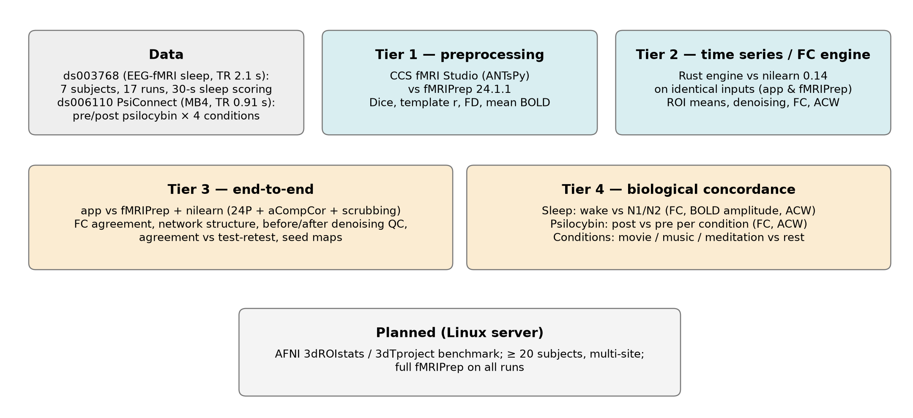
*Figure 1. Datasets and the four validation tiers.*

### 3.2 Tier 1: preprocessing vs fMRIPrep
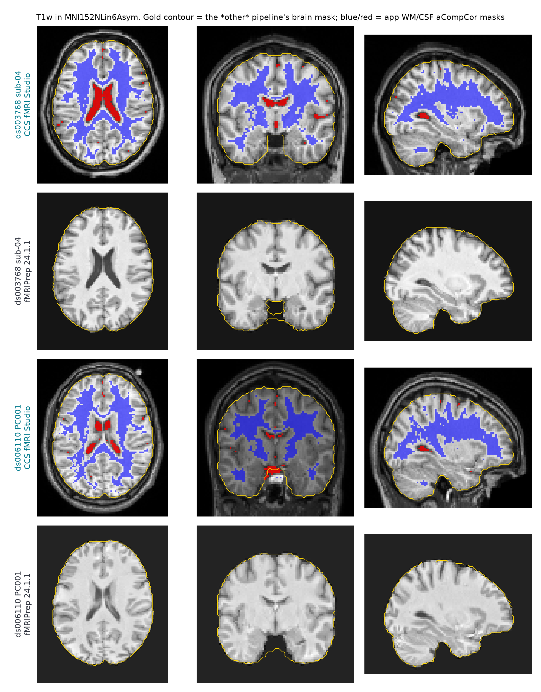
*Figure 2. T1w in MNI152NLin6Asym for the app and fMRIPrep in two subjects from both datasets. Gold contour = the other pipeline's brain mask. Blue/red = the app's WM/CSF aCompCor masks (deep WM, ventricles).*

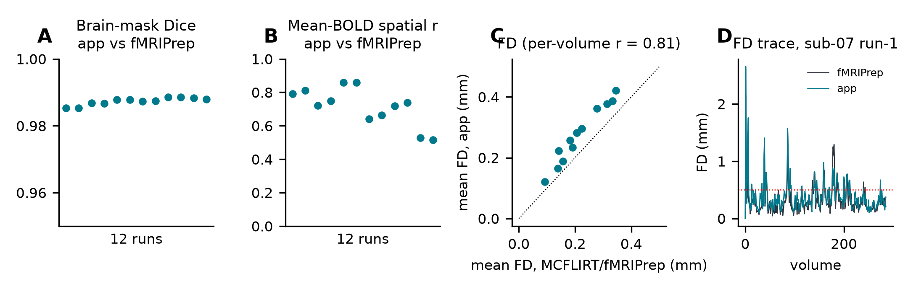
*Figure 3. (A) Brain-mask Dice and (B) mean-BOLD spatial correlation, app vs fMRIPrep; (C) mean FD; (D) FD trace of a high-motion run.*

- **Brain masks:** Dice **0.987** (0.985–0.989; 12 runs). T1w–template r 0.74–0.80.
- **Mean BOLD in MNI space:** spatial r 0.72 (0.52–0.86) with fMRIPrep, which applies boundary-based coregistration.
- **FD:** per-volume r = **0.81** (0.53–0.92). The app's FD is systematically higher (mean 0.28 vs 0.22 mm, ×1.27; 27 vs 17 frames > 0.5 mm per run).

  We tested alternative motion-estimation settings against MCFLIRT's FD (`tables/motion_estimation_tuning_vs_mcflirt.csv`): dense sampling, a 3-level pyramid, a smoothed pyramid and a skull-stripped EPI reference. The current setting was within 2 % of the best variant. Skull-stripping the reference made agreement worse (ratio ×2–10). The residual offset therefore reflects estimator noise relative to MCFLIRT, not an error.

### 3.3 Tier 2: time-series and connectivity engine vs nilearn
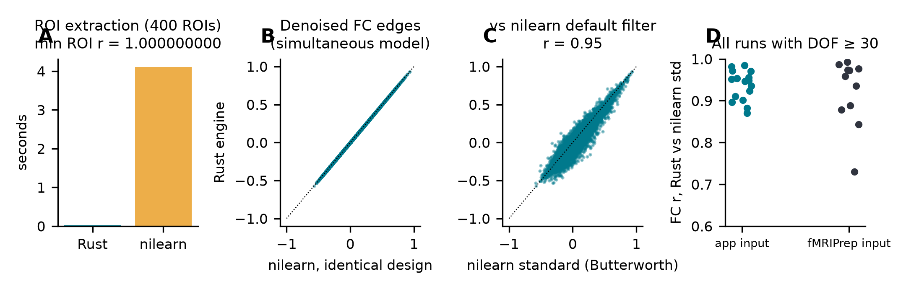
*Figure 4. (A) ROI extraction time and identity; (B) denoised FC, Rust vs nilearn given the same design; (C) vs nilearn's default Butterworth filter; (D) agreement across all runs with DOF ≥ 30, on app- and fMRIPrep-preprocessed inputs.*

| Component | Result |
|---|---|
| ROI means (400 parcels) | identical to `NiftiLabelsMasker` (min r 0.99999999995; rel. diff 4·10⁻⁸); **19 ms vs 4.1 s** |
| Denoising, same design | identical in **34/37 runs** (FC r = 1.000, max \|Δ\| ≤ 3·10⁻⁶). The 3 exceptions have 5–20 residual DOF, where the design is near-singular |
| Denoising vs nilearn standard (Butterworth) | FC r median **0.95** (app inputs, 0.87–0.99) and **0.96** (fMRIPrep inputs, 0.73–0.99) for DOF ≥ 30. The difference reflects DCT vs Butterworth filter shape |
| Dynamics (ACW-0) | identical to a NumPy ACF implementation (r = 1.000, max \|Δ\| = 0 s) |

### 3.4 Tier 3: end-to-end, and before/after denoising
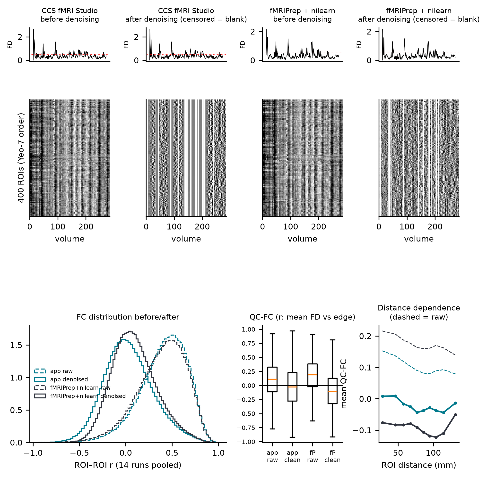
*Figure 5. Before/after denoising for a high-motion run (sub-07 run-1): ROI carpet plots with FD, for the app and fMRIPrep + nilearn (censored frames blank). Bottom: FC distributions before/after (14 runs pooled), QC-FC (across-run correlation of mean FD with each edge) and its distance dependence.*

- **Denoising effect.** Denoising removed the motion-locked vertical bands and the global positive shift of FC in both pipelines: mean raw FC 0.41/0.39 became 0.03 (app) and 0.09 (reference). The app's slightly stronger global reduction is consistent with its higher censoring.
- **Motion signature.** Distance-dependence of QC-FC fell in both pipelines (ρ −0.078 → −0.033 app; −0.074 → −0.010 reference). Median |QC-FC| stayed about 0.24–0.26 in both. With 14 runs from 7 subjects in two datasets, QC-FC is dominated by between-subject and dataset differences, so this metric is reported for completeness and is not interpreted.

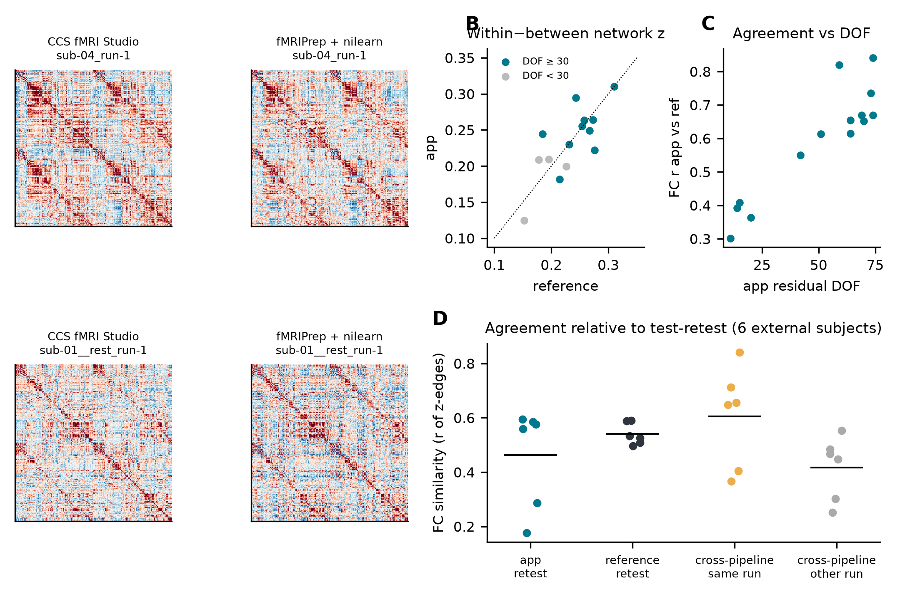
*Figure 6. (A) FC matrices from the app and the reference; (B) network segregation; (C) agreement vs residual DOF; (D) cross-pipeline agreement compared with each pipeline's test-retest reliability.*

| Metric (14 runs) | Value |
|---|---|
| FC edge r, app vs reference | 0.59 overall; **0.68** (0.55–0.84) in runs with DOF ≥ 30 |
| Yeo-7 network-matrix r | median **0.87** (0.62–0.96) |
| Within−between network z (DOF ≥ 30) | app **0.252**, reference **0.251** |
| Raw (pre-denoising) FC r, app vs reference | 0.70 (preprocessing alone) |

Across the 6 external subjects (two rest runs each):

| | Mean |
|---|---|
| App run-1 ↔ run-2 | 0.46 |
| Reference run-1 ↔ run-2 | 0.54 |
| **App ↔ reference, same run** | **0.60** |
| App ↔ reference, other run | 0.42 |

- **Agreement exceeds reliability.** Same-run agreement exceeded both pipelines' own reliability, so differences between the pipelines are smaller than scan-to-scan variability.
- **Low DOF.** Agreement falls in the high-motion runs, where the app's higher FD leaves only 11–20 residual DOF (Fig. 6C).
- **Sleep-state confound.** The official scoring shows that several "rest" runs were partly asleep. For example, sub-03 had both runs in N2 and sub-06 run-2 was N1/N2, so part of the test-retest variance is real state change (§3.6).

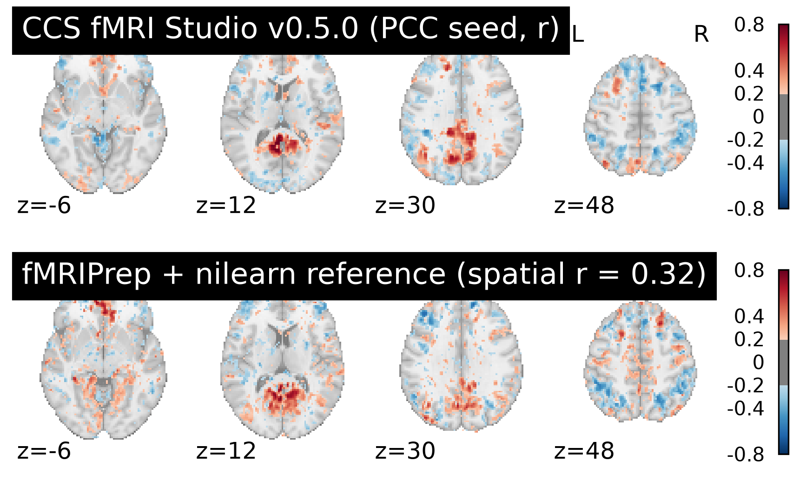
*Figure 8. PCC seed maps, app vs fMRIPrep + nilearn (ds003768 sub-01 rest-1).*

**Seed maps.** Both maps show the posterior-cingulate / precuneus core and medial parietal–prefrontal coupling. The app's map has 6,829 FDR voxels at 69 DOF. Voxel-wise spatial agreement was modest (r = 0.32; top-10 % Dice 0.27). Voxel-level maps from a single 10-min run, most of it N2 sleep, are far noisier than parcel-level FC, and the two pipelines use different confound sets. Seed maps should be interpreted at the cluster level.

### 3.5 Tier 4a: biological concordance in sleep (ds003768)
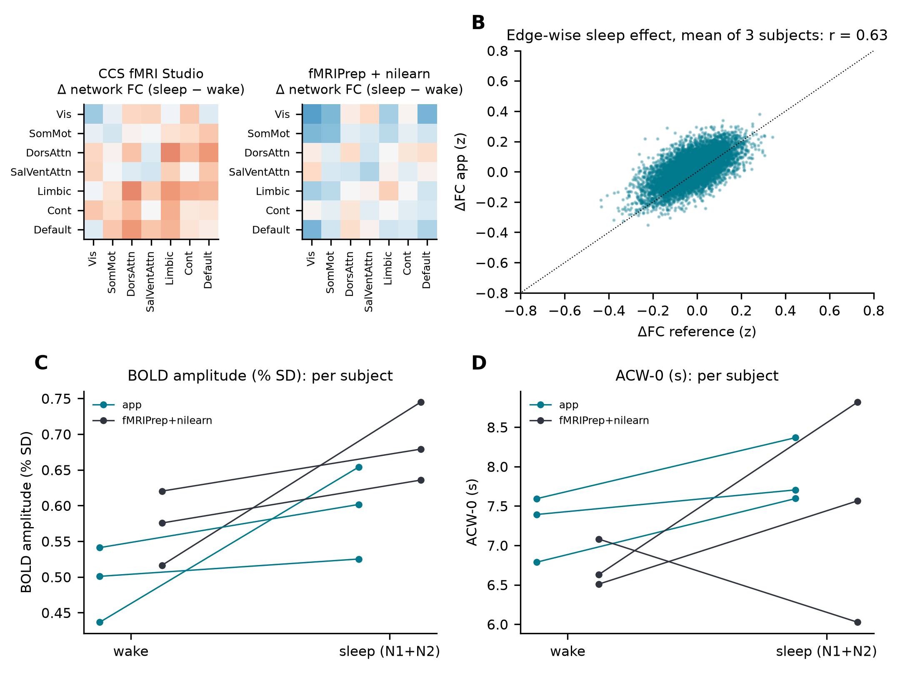
*Figure 7. Sleep (N1+N2) vs wake within subjects. (A) Δ network FC for the app and the reference (mean of 3 subjects with ≥ 40 retained frames per state). (B) Edge-wise ΔFC, app vs reference. (C) BOLD fluctuation amplitude and (D) intrinsic timescale (ACW-0), per subject and pipeline.*

| Effect (3 subjects: sub-02, sub-04, sub-06) | App | Reference | Concordance |
|---|---|---|---|
| BOLD amplitude, sleep > wake | 3/3 (+0.22, +0.06, +0.02 %) | 3/3 (+0.23, +0.06, +0.06 %) | same direction 3/3 |
| ACW-0, sleep > wake | 3/3 | 2/3 | ROI-wise ΔACW r = 0.38–0.61 |
| Edge-wise ΔFC | | | r = **0.54–0.72** per subject; **0.63** for the group mean |
| Network-level ΔFC | | | r = **0.57–0.87** |

- **Amplitude.** Both pipelines reproduce the well-established increase in low-frequency BOLD fluctuation amplitude in light NREM sleep (Fukunaga et al., 2006; Horovitz et al., 2008).
- **Timescales.** Both reproduce the lengthening of intrinsic timescales (except one reference estimate).
- **FC changes.** The *pattern* of FC change agrees (r = 0.63). The app's ΔFC is shifted towards more positive values (Fig. 7A), consistent with its stronger censoring and global-signal reduction.
- **sub-01 (all 5 runs, engine level).** Rust and nilearn on identical data gave the same decrease in network segregation from wake to sleep: 0.209 → 0.184 (Rust) and 0.204 → 0.183 (nilearn).

### 3.6 Tier 4b: biological concordance under psilocybin and naturalistic conditions (ds006110)

Full fMRIPrep derivatives were not computed for these runs, so this tier compares the app's Rust engine with nilearn on identical app-preprocessed data. For the pre-session rest run, app vs fMRIPrep + nilearn under the same settings gave FC r = 0.66 and network-matrix r = 0.76.

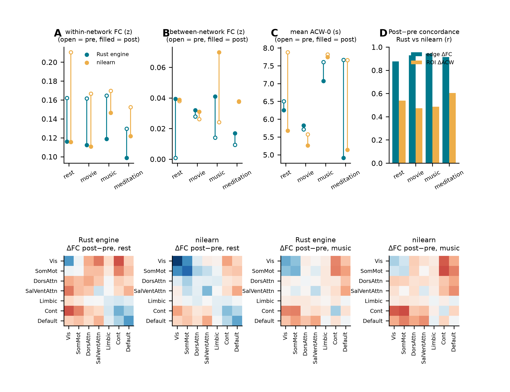
*Figure 9. Psilocybin, post vs pre, per condition. (A) within-network FC, (B) between-network FC, (C) mean ACW-0 for the Rust engine and nilearn; (D) concordance of post−pre effects; bottom: Δ network FC for rest and music.*

| Condition | Within-network FC, post−pre (Rust / nilearn) | Between-network FC (Rust / nilearn) | Edge ΔFC r | Network ΔFC r | ROI ΔACW r |
|---|---|---|---|---|---|
| rest | −0.046 / −0.094 | +0.038 / +0.001 | **0.88** | 0.68 | 0.54 |
| movie | −0.050 / −0.056 | +0.004 / +0.005 | **0.93** | 0.95 | 0.47 |
| music | −0.046 / −0.024 | +0.027 / +0.046 | **0.94** | 0.95 | 0.49 |
| meditation | −0.030 / −0.030 | +0.008 / 0.000 | **0.91** | 0.83 | 0.60 |

- **Network desegregation.** Both engines show reduced within-network FC after psilocybin in all four contexts, with between-network FC unchanged or increased. This is the network-desegregation signature reported for psilocybin (Carhart-Harris et al., 2012; Siegel et al., 2024).
- **Timescales.** Intrinsic timescales shortened in rest, music and meditation with both engines. This is consistent with flattened cortical timescales under psychedelics.
- **Caveats.** This is one participant. Motion was higher after dosing (mean FD 0.22–0.47 vs 0.13–0.18 mm), so these results show *concordance between engines*, not an effect estimate.

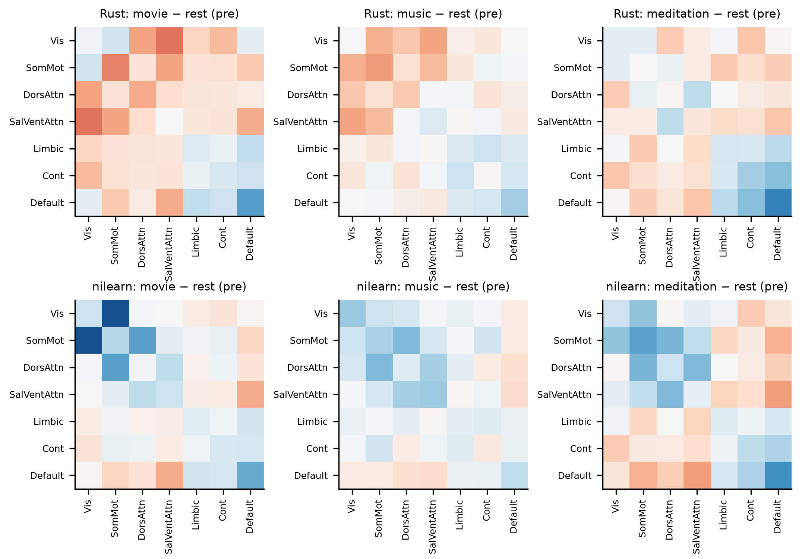
*Figure 10. Naturalistic conditions vs rest (pre-session): Δ network FC, Rust vs nilearn.*

Condition contrasts agreed edge-wise at r = 0.82 (movie − rest), 0.74 (music − rest) and 0.89 (meditation − rest). Network-level agreement was lower where effects were small (music − rest, r = −0.07).

### 3.7 Runtime
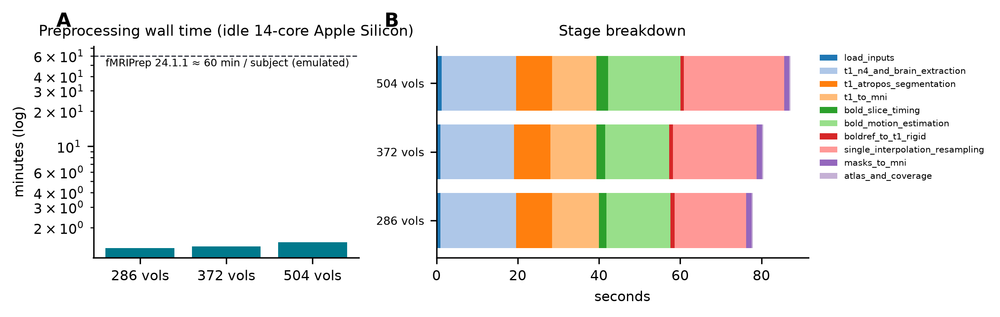
*Figure 11. (A) Preprocessing wall time per run on an idle 14-core Apple Silicon machine; (B) stage breakdown.*

| Pipeline | Time |
|---|---|
| CCS fMRI Studio v0.5.0 | **80 s** (286 volumes), **83 s** (372), **90 s** (504); peak RSS 5.0–6.9 GB |
| fMRIPrep 24.1.1 (`--fs-no-reconall`, x86 emulation) | ≈60 min per subject |
| Rust parcellation + denoising + FC | < 0.5 s per run (excluding aCompCor PCA, about 1 s) |

### 3.8 Robustness safeguards found necessary during validation

Three failure modes, each silent in earlier versions, were found and fixed. Each now raises an error or is corrected automatically:
1. **Zero-filled inputs.** ITK returned zero-filled volumes when reading NIfTI files from a cloud-synced (Google Drive "online-only") folder that was still downloading; this affected 9 of 13 runs on first read. Inputs are now verified against nibabel and re-read.
2. **Corrupted volumes in memory.** Numpy views of ANTs image buffers corrupted volumes after slice-timing correction. Data are now Python-owned, with a volume-intensity sanity check.
3. **Non-converging aCompCor SVD.** An SVD failed to converge for one large mask, producing NaN components. A Gram-matrix fallback was added, and non-finite confounds are rejected.

## 4. Discussion

CCS fMRI Studio v0.5.0 matches the gold standard where it can be identical, and agrees within reliability bounds where valid pipelines legitimately differ:

- Its numerical engine reproduces nilearn exactly given the same model.
- Its anatomical preprocessing matches fMRIPrep's brain masks.
- Its connectomes agree with fMRIPrep + nilearn more closely than either pipeline agrees with itself across runs, and recover the same network structure.

Most importantly for applied use, it reproduces biologically meaningful *changes*: the increase of BOLD fluctuation amplitude and timescales in light sleep, and the reduced within-network FC under psilocybin. The pattern of FC change matched the reference with r = 0.6–0.9.

**Differences and how to close them.**
1. **FD runs ~27 % higher than MCFLIRT's,** leading to more censoring and lower DOF in high-motion runs. The options are an FD threshold calibrated to fMRIPrep (≈0.6 mm), DVARS-informed censoring, or MCFLIRT-style estimation against a single-volume reference.
2. **DCT band-pass consumes DOF explicitly.** This is honest, but limiting at TR < 1 s. For short-TR, high-motion data we recommend high-pass-only (as used for the biological analyses) or a 0.01–0.1 Hz band.
3. **Coregistration is rigid MI, not BBR,** and there is **no susceptibility-distortion correction.** These are the main sources of the remaining mean-BOLD differences (r 0.72).
4. **Default confounds are 12P vs fMRIPrep's 24P.** Exposing 24P as an option is straightforward.

**Limitations.**
- The sample is small: 7 + 1 subjects, and only 3 subjects with enough wake and sleep data.
- fMRIPrep derivatives were limited to 14 runs.
- PsiConnect analyses compare engines on app preprocessing, not end-to-end.
- Only one of the multi-echo PsiConnect echoes was used.

**Planned work (Linux server).**
- AFNI `3dROIstats` and `3dTproject` benchmarks of the ROI extraction and simultaneous regression;
- fMRIPrep on all runs, including the PsiConnect sessions;
- ≥ 20 subjects from ≥ 2 sites with edge-wise ICC;
- group-level psilocybin and sleep effects.

## 5. Data and code availability

| Item | Location |
|---|---|
| Code | `CCS-NIMHANS/CCS_fMRIStudio` release v0.5.0 |
| Analysis code | [`scripts/`](scripts/) (`common.py`, `analysis.py`, `figures.py`, `parcellation_and_seed.py`; Rust harness in `scripts/rust_harness/`) |
| Tables | [`tables/`](tables/) |
| Figures | [`figures/`](figures/) (300 dpi) · [PDF version](REPORT.pdf) |
| Per-run QC reports | written by the app as `qc_report.html` next to each preprocessing output (not included here because of size) |
| Data | OpenNeuro ds003768 and ds006110 (CC0) |

## References
- Abraham A et al. (2014) Machine learning for neuroimaging with scikit-learn (nilearn). *Front Neuroinform* 8:14.
- Avants BB et al. (2008) *Med Image Anal* 12:26.
- Behzadi Y et al. (2007) *NeuroImage* 37:90.
- Carhart-Harris RL et al. (2012) *PNAS* 109:2138.
- Ciric R et al. (2017) *NeuroImage* 154:174.
- Cox RW (1996) AFNI. *Comput Biomed Res* 29:162.
- Esteban O et al. (2019) fMRIPrep. *Nat Methods* 16:111.
- Fukunaga M et al. (2006) *Magn Reson Imaging* 24:979.
- Honey CJ et al. (2012) *Neuron* 76:423.
- Horovitz SG et al. (2008) *Hum Brain Mapp* 29:671.
- Novelli L et al. (2026) PsiConnect. *Sci Data*.
- Power JD et al. (2012) *NeuroImage* 59:2142.
- Power JD et al. (2014) *NeuroImage* 84:320.
- Schaefer A et al. (2018) *Cereb Cortex* 28:3095.
- Siegel JS et al. (2024) *Nature* 632:131.
- Stoliker D et al. (2026) *Nature*.
- Tustison NJ et al. (2010) *IEEE TMI* 29:1310.
