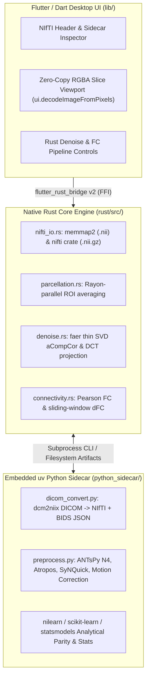

# 1. Architecture & Hybrid Engine

**CCS fMRI Studio** mirrors the hybrid philosophy of **CCS EEG Studio** by separating interactive visualization and linear-algebra-heavy timeseries processing from battle-tested spatial registration and statistical modeling.

---

## Three-Layer Architecture

---

## Why Hybrid Rust + ANTsPy Instead of Wrapping FSL / AFNI / fMRIPrep?

| Requirement | FSL / AFNI / Docker fMRIPrep | CCS_fMRIStudio Hybrid Engine |
| :--- | :--- | :--- |
| **Windows Support** | Requires WSL2 or Docker Desktop | Native `ccs_fmri_core.dll` + native `antspyx` wheels |
| **macOS Apple Silicon** | Rosetta / Docker overhead; 2–4 hr/subject | Native `arm64` C++/ITK wheels + Rust SIMD (~1.7 min/subject) |
| **Zero-Code UX** | CLI scripts, environment paths, licensing | Single desktop app bundle + relocatable `uv` environment |
| **24 GB Laptop RAM** | High container + Python array duplication | Zero-copy `memmap2` `.nii` mapping (`float32` on disk) |

---

## Key Memory Safeguards for 24 GB Laptops

1. **Zero-Copy Memory-Mapped `.nii` I/O (`rust/src/nifti_io.rs`)**:
   When loading an uncompressed native-endian `float32` `.nii` volume with trivial scaling (`scl_slope` 0 or 1, `scl_inter` 0) and 4-byte-aligned `vox_offset`, `BoldVolume::MmapF32` maps the file directly via `memmap2::Mmap` and builds a Fortran-order (`[X, Y, Z, T]`) `ArrayView4<f32>` with **zero heap allocation**.
2. **Column-Major Slicing Efficiency**:
   Because NIfTI stores 4D volumes in Fortran order (`[X, Y, Z, T]`), every 3D brain volume at timepoint `t` is contiguous in memory, enabling lock-free Rayon parallelism across timepoints and instant single-slice extraction for the Flutter viewport.
3. **Double-Precision Only on Compact Matrices**:
   4D brain volumes always remain in `float32`. Only compact 2D `(T × N_rois)` or `(T × V_mask)` matrices are promoted to `f64` for `faer::Mat::thin_svd()`.
4. **Bundled FFI Resolution (`lib/src/rust_loader.dart`)**:
   `openBundledRustLibrary()` automatically resolves `libccs_fmri_core.dylib` (`Contents/Frameworks/` on macOS), `ccs_fmri_core.dll` (next to `.exe` on Windows), `libccs_fmri_core.so` (`lib/` on Linux), and `rust/target/{release,debug}` during local development.
