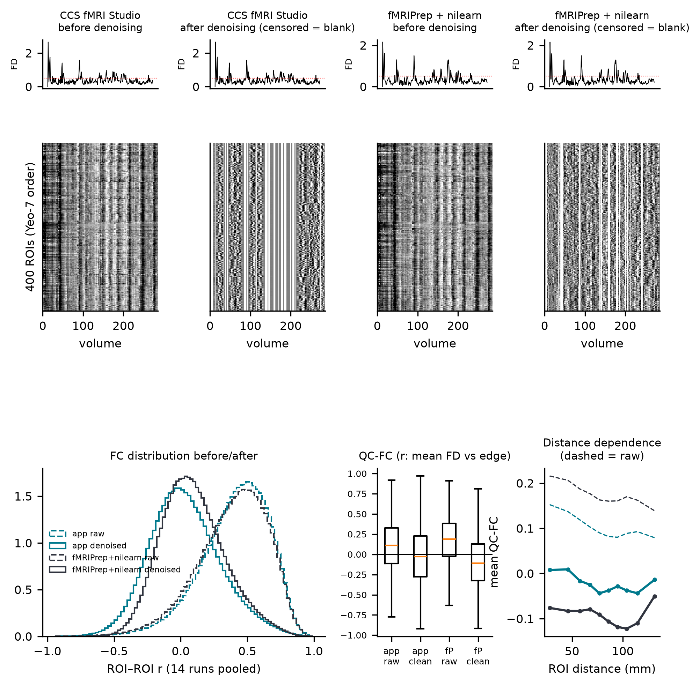
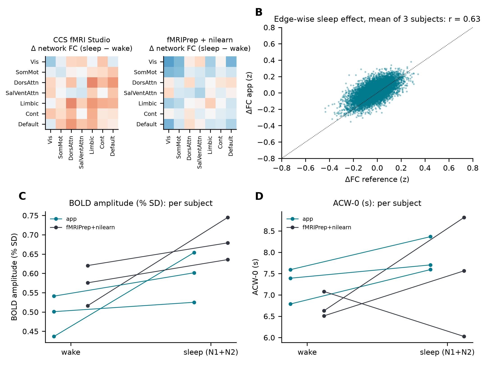
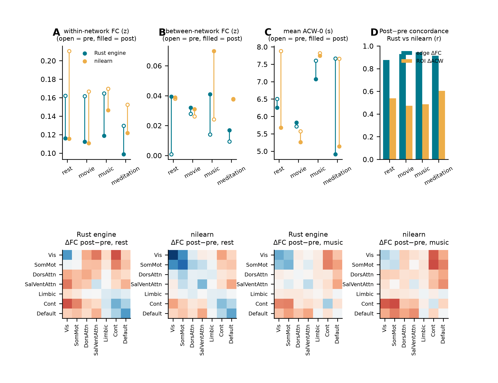

# 4. Benchmarks & Validation

## v0.5.0 validation (current)

The full report is [**docs/validation/v0.5.0/REPORT.md**](../validation/v0.5.0/REPORT.md) ([PDF](../validation/v0.5.0/REPORT.pdf)).
It covers 25 runs from OpenNeuro ds003768 (EEG-fMRI with 30-s sleep scoring) and ds006110 (PsiConnect, before and after psilocybin, across rest, movie, music and meditation).

| Tier | Gold standard | Result |
| :--- | :--- | :--- |
| 1. Preprocessing | fMRIPrep 24.1.1 | brain-mask Dice 0.987 (0.985–0.989); mean-BOLD spatial r 0.72; FD r 0.81 (app FD ≈ 1.27× MCFLIRT's) |
| 2. Time-series / FC engine | nilearn 0.14, identical inputs | ROI means identical (min r > 0.99999999; 19 ms vs 4.1 s); denoising identical given the same design in 34/37 runs; FC r 0.95 vs nilearn Butterworth; ACW identical to NumPy |
| 3. End-to-end | fMRIPrep + nilearn (24P + aCompCor + scrubbing) | FC r 0.68 (DOF ≥ 30), network-matrix r 0.87, identical network segregation; same-run agreement 0.60 > test-retest 0.46 (app) / 0.54 (reference) |
| 4. Biological concordance | same | Sleep (N1+N2 vs wake): BOLD amplitude ↑ in 3/3 subjects with both pipelines, ΔFC r 0.63. Psilocybin: within-network FC ↓ in 4/4 conditions with both engines, ΔFC r 0.88–0.94 |
| Runtime | fMRIPrep ≈ 60 min / subject (emulated) | 80–90 s per run on a 14-core Apple Silicon Mac |

| Figure | |
| :--- | :--- |
|  | Before/after denoising: carpet plots, FC distributions, QC-FC (app and fMRIPrep + nilearn) |
|  | Sleep-stage concordance |
|  | Psilocybin concordance |

The planned next steps are an AFNI `3dROIstats` / `3dTproject` benchmark and a sample of 20 or more subjects from two or more sites, run on a Linux server.

---

## Historical (v0.4.x) Rust-core speed benchmarks

> The preprocessing numbers below were measured with v0.4.1. That version registered a skull-on T1w to a brain-only template and built aCompCor masks from a whole-head segmentation, which v0.5.0 fixes. Treat its preprocessing outputs as superseded. The Rust parcellation, denoising and FC timings remain representative.

All preprocessing, speedups, peak RAM measurements, and numerical parity tests were verified end-to-end on clinical resting-state fMRI + T1w DICOM data (`Patient_01/pre`, Siemens 3T MR-PET, NIMHANS) on an Apple Silicon MacBook Pro (24 GB RAM).

---

## 1. ANTsPy Preprocessing Runtime & Memory (`Patient_01/pre`)

- **Input**: Raw Siemens DICOMs (`t1w`: `176 × 256 × 256` 1.0 mm iso; `bold`: `64 × 64 × 40 × 450`, `3.4375 × 3.4375 × 4.25 mm`, `TR = 2.0 s`, 40 slice timings)
- **MNI152 2 mm Output**: `99 × 117 × 95 × 450` (`400` Schaefer parcels, `6,450` WM mask voxels, `40,457` CSF mask voxels)
- **Head Motion**: Mean Power FD `1.374 mm`, Max Power FD `47.526 mm` (clinical motion spikes around frames 78–87; `98` frames flagged at `FD > 0.5 mm`)

| Preprocessing Stage | Wall Time (s) | RSS After Stage (MB) | Peak RSS (MB) |
| :--- | ---: | ---: | ---: |
| Load T1w + 4D BOLD (`float32`) | 0.38 | 621.6 | 902.9 |
| T1w N4 Bias-Field Correction | 3.59 | 1,225.2 | 1,225.2 |
| Atropos 3-Class Tissue Segmentation (WM/CSF) | 17.18 | 2,243.7 | 2,495.4 |
| T1w → MNI152 2 mm (`antsRegistrationSyNQuick[s]`) | 2.52 | 2,112.5 | 2,562.0 |
| 4D BOLD Rigid Motion Correction (450 vols) | 47.71 | 2,296.0 | 2,953.5 |
| Mean BOLD → T1w Rigid Coregistration | 2.20 | 2,473.8 | 2,953.5 |
| Single-Interpolation 4D MNI Warp + Mask Warps | 28.31 | 5,513.6 | 7,227.0 |
| Schaefer-400 Atlas Alignment | 0.04 | 5,532.2 | 7,227.0 |
| **Total End-to-End Preprocessing** | **101.93 s (1.70 min)** | **5,532.2 MB** | **7,227.0 MB (~7.1 GB)** |

---

## 2. Rust Core vs. `nilearn` Benchmark (3 Repeated Trials)

Benchmark workload (`99 × 117 × 95 × 450` float32 MNI volume, ~1.98 GB uncompressed):
1. Load 4D BOLD + Schaefer-400 atlas + WM/CSF masks + `confounds.tsv`
2. Extract 400 Schaefer ROI mean timeseries
3. Compute WM (5) + CSF (5) aCompCor PCA components
4. Simultaneous denoising (22 motion+aCompCor confounds + 98 FD>0.5 mm scrubbing spikes + `0.008–0.09 Hz` bandpass)
5. Compute static `400 × 400` Pearson FC matrix

Each configuration ran **3 isolated trials** via `benchmark_vs_nilearn.py --repeats 3`, with Rust peak RSS measured via `/usr/bin/time -l` and each `nilearn` run executed in an isolated Python subprocess.

| Stage / Metric | Rust `.nii` (`memmap2`) Median [Min–Max] | `nilearn` `.nii` Median [Min–Max] | Rust `.nii.gz` Median [Min–Max] | `nilearn` `.nii.gz` Median [Min–Max] |
| :--- | ---: | ---: | ---: | ---: |
| **Load** | 3.32 ms [3.17–5.25] | 2.19 ms [1.98–4.56] | 3,234.20 ms [3,203.58–3,626.29] | 2.31 ms [1.92–2.47] |
| **Schaefer-400 Parcellation** | **28.20 ms** [27.31–677.81] | 4,453.02 ms [4,399.43–5,622.71] | **16.94 ms** [16.29–17.74] | 12,189.47 ms [11,408.38–12,411.19] |
| **WM + CSF aCompCor (5+5)** | **604.65 ms** [602.80–1,356.18] | 4,620.74 ms [4,592.37–4,653.77] | **622.72 ms** [596.67–657.14] | 14,384.53 ms [14,264.71–14,982.29] |
| **Denoise (DCT / Butterworth)** | **32.56 ms** [31.68–32.89] | 51.27 ms [50.46–54.09] | **33.09 ms** [31.43–33.16] | 50.74 ms [50.43–54.54] |
| **400×400 Pearson FC** | 2.81 ms [2.76–2.81] | 0.56 ms [0.53–0.68] | 2.89 ms [2.82–2.96] | 0.57 ms [0.56–0.58] |
| **Total End-to-End** | **670.55 ms** [668.87–2,074.95] | **9,161.38 ms** [9,073.56–10,274.76] | **3,883.26 ms** [3,880.15–4,334.69] | **26,628.17 ms** [25,726.76–27,450.97] |
| **Peak RSS Memory** | **2,244.58 MB** [2,242.78–2,248.08] | 4,105.03 MB [4,104.75–4,115.80] | 4,574.94 MB [4,525.09–4,575.09] | 4,119.31 MB [4,114.62–4,128.84] |

### Verified Median Speedups & Memory Savings

- **Total End-to-End (`.nii` `memmap2` vs. `nilearn`)**: **13.66× faster** (and **4.95× faster** even on the cold first-touch trial `2,074.95 ms` vs. `10,274.76 ms`)
- **Schaefer-400 Parcellation (`.nii` `memmap2` vs. `nilearn`)**: **157.91× faster**
- **WM/CSF aCompCor (`.nii` `memmap2` vs. `nilearn`)**: **7.64× faster**
- **Simultaneous Denoising vs. `nilearn` Butterworth**: **1.57× faster**
- **Total End-to-End (`.nii.gz` vs. `nilearn`)**: **6.86× faster**
- **Peak RSS Memory (`.nii` `memmap2` vs. `nilearn`)**: **1.83× lower** (`2,244.58 MB` vs. `4,105.03 MB`)

---

## 3. Numerical Parity vs. `nilearn` (400 Schaefer ROIs)

| Comparison | ROIs | Mean $r$ | Median $r$ | Min $r$ | Max $r$ |
| :--- | ---: | ---: | ---: | ---: | ---: |
| **Rust DCT High-Pass (`0.008 Hz`) vs. `nilearn` `filter='cosine'`** | 400 | **0.99999999999867** | **0.99999999999885** | **0.99999999999476** | **0.99999999999999** |
| **Rust DCT Bandpass (`0.008–0.09 Hz`) vs. `nilearn` `filter='butterworth'`** | 400 | 0.9200 | 0.9230 | 0.8181 | 0.9777 |

> Note: `nilearn.signal.clean(..., filter='cosine')` currently only implements high-pass DCT drift removal (`low_pass` is unimplemented in cosine mode). Rust's `build_dct_stopband_basis` handles **both** high-pass and low-pass DCT-II stopband frequencies in a single orthogonalized SVD projection without IIR edge ringing.
