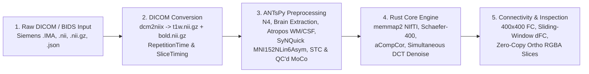

# CCS fMRI Studio Wiki

A visual, technical guide to **CCS fMRI Studio** — a cross-platform desktop fMRI preprocessing, denoising, parcellation, and EEG-style timeseries/connectivity workbench powered by **Flutter + Rust + an embedded ANTsPy/nilearn Python sidecar** without FSL, AFNI, or Docker dependencies.

> 📄 **New in v0.5.0:** [Validation Report](../validation/v0.5.0/REPORT.md) ([PDF](../validation/v0.5.0/REPORT.pdf)): benchmarks against fMRIPrep and nilearn, plus concordance of sleep and psilocybin effects. The app can generate the same style of publication figures from your own data (Summary & Export → *Generate Publication Figures*; Stats → *Group Publication Figures*).

---

## End-to-End Workflow Map

---

## Wiki Guides

| Guide | Topics Covered |
| :--- | :--- |
| [**1. Architecture & Hybrid Engine**](Architecture-and-Hybrid-Engine.md) | Flutter UI, `flutter_rust_bridge` v2 FFI, Rust `memmap2` + `faer` + `rayon` engine, `uv` Python sidecar, and 24 GB RAM safeguards |
| [**2. Preprocessing & DICOM / BIDS**](Preprocessing-and-DICOM-BIDS.md) | `dcm2niix` Siemens `.IMA` conversion, ANTsPy N4 bias correction, Atropos segmentation, `SyNQuick` MNI152, rigid motion correction, and `confounds.tsv` |
| [**3. Rust Denoising & Connectivity**](Rust-Denoising-and-Connectivity.md) | Parallel Schaefer parcellation, CONN-style WM/CSF aCompCor, simultaneous orthogonalized DCT bandpass + scrubbing projection, static/dynamic FC, and RGBA slice rendering |
| [**4. Benchmarks & Validation**](Benchmarks-and-Validation.md) | **[v0.5.0 Validation Report](../validation/v0.5.0/REPORT.md)**: fMRIPrep / nilearn benchmarks, before/after denoising, sleep & psilocybin concordance; Rust-core speed benchmarks |
| [**5. Building & Releasing (3 OSes)**](Building-and-Releasing.md) | Local macOS/Linux/Windows compilation, `flutter_rust_bridge_codegen`, GitHub Actions 3-OS release pipeline, and SHA-256 verification |
| [**6. TBI & Stroke Lesion Workflows**](TBI-and-Stroke-Lesion-Workflows.md) | Auto-segmentation + Flutter 3D mask editor, CFM & Enantiomorphic registration, clinical templates, lesion-safe aCompCor, NaN-safe graph & LMM |

---

## Supported Inputs & Outputs

| Category | Formats / Outputs |
| :--- | :--- |
| **Raw Inputs** | Siemens `.IMA` / DICOM folders (`dcm2niix`), 3D/4D `.nii` and `.nii.gz`, BIDS `.json` sidecars (`RepetitionTime`, `SliceTiming`) |
| **Preprocessed Artifacts** | `bold_mni.nii` (uncompressed float32 for zero-copy `memmap2`), optional `bold_mni.nii.gz` (`--write-gz`), `t1w_mni.nii.gz`, `brain_mask_mni.nii.gz`, `wm_mask_mni.nii.gz`, `csf_mask_mni.nii.gz`, `schaefer400_mni.nii.gz`, `confounds.tsv`, `parcel_coverage.csv`, `preprocess_report.json`, `qc_report.html` |
| **Rust Engine Outputs** | `fc_matrix.csv`, `denoised_timeseries.csv`, `raw_timeseries.csv`, `censor_mask.csv`, `confounds_used.csv`, `biomarkers_summary.json`, `clinical_report.md`, and live RGBA slice pixel buffers |

---

## Companion CCS Studio Projects

- [**CCS EEG Studio**](https://github.com/CCS-NIMHANS/CCS_EEGStudio) — Native-speed EEG preprocessing, ERP/ERSP/rERP, source imaging, and microstate workbench.
- [**CCS Sleep Studio**](https://github.com/CCS-NIMHANS/CCS_SleepStudio) · [**CCS Mobile Studio**](https://github.com/CCS-NIMHANS/CCS_MobileStudio) · [**CCS PPG Studio**](https://github.com/CCS-NIMHANS/CCS_PPGStudio)
