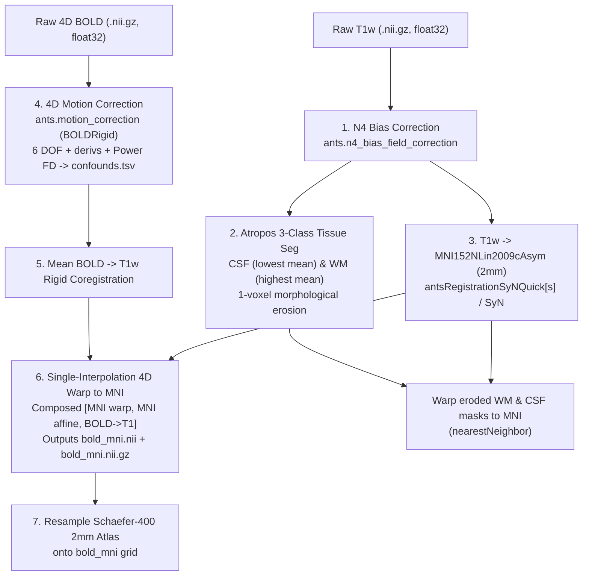

# 2. Preprocessing & DICOM / BIDS Ingestion

The Python sidecar (`python_sidecar/src/ccs_fmri_sidecar/`) converts clinical DICOM directories into BIDS-compliant NIfTI volumes and runs a fast, reproducible ANTsPy structural + functional preprocessing workflow.

---

## Stage 1: DICOM to NIfTI + BIDS JSON (`dicom_convert.py`)

Siemens mosaic `.IMA` files pack all axial slices of a single fMRI volume into a 2D mosaic image with CSA slice-timing headers. `dicom_convert.py` invokes `dcm2niix -z y -b y` into isolated per-modality staging directories and automatically selects:
- **3D T1w anatomical** (`t1w.nii.gz` + `t1w.json`)
- **4D BOLD timeseries** (`bold.nii.gz` + `bold.json`) with verified `RepetitionTime` (`TR`) and `SliceTiming` arrays.

```bash
cd python_sidecar
uv run python -m ccs_fmri_sidecar.dicom_convert \
  --t1-dicom /path/to/T1_DICOM_DIR \
  --bold-dicom /path/to/BOLD_DICOM_DIR \
  --out ../data_test_output/subject/raw
```

---

## Stage 2: ANTsPy Preprocessing (`preprocess.py`)



### Confounds Schema (`confounds.tsv`)

Each row corresponds to one fMRI volume (`0..T-1`), with columns:
- **6 Rigid-Body Parameters**: `trans_x`, `trans_y`, `trans_z` (mm, extracted from ITK `AffineTransform` translations) and `rot_x`, `rot_y`, `rot_z` (radians, SVD-projected orthonormal rotation matrix converted via `scipy.spatial.transform.Rotation.as_euler('xyz')`).
- **6 Temporal Derivatives**: `trans_{x,y,z}_derivative1`, `rot_{x,y,z}_derivative1` (`0` at `t=0`, backward difference `x[t] - x[t-1]` for `t >= 1`).
- **Motion Summary**:
  - `framewise_displacement`: Power et al. (2012) FD on a 50 mm radius sphere:
    $$\text{FD}_t = |\Delta t_x| + |\Delta t_y| + |\Delta t_z| + 50 \left(|\Delta r_x| + |\Delta r_y| + |\Delta r_z|\right)$$
  - `ants_fd`: ANTsPy's native landmark displacement FD for cross-checking.

### Real-World Run on `Patient_01/pre` (Apple Silicon, 24 GB RAM)

- **Raw Inputs**: T1w `176 × 256 × 256` (`1.0 mm` iso), BOLD `64 × 64 × 40 × 450` (`3.44 × 3.44 × 4.25 mm`, `TR = 2.0 s`).
- **MNI Outputs**: `bold_mni.nii` / `bold_mni.nii.gz` (`99 × 117 × 95 × 450`), `400` Schaefer ROIs, `6,450` WM mask voxels, `40,457` CSF mask voxels.
- **Total Wall-Clock Time**: **101.93 s** (`1.70 min`), Peak RSS: **7,226.97 MB**.
