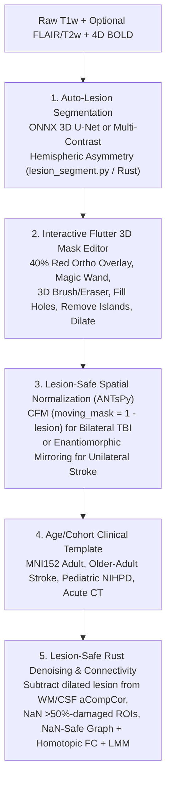

# 6. TBI & Stroke Clinical Lesion Workflows

Standard resting-state and task fMRI pipelines fail in Traumatic Brain Injury (TBI) and focal stroke due to three artifacts: **spatial warping distortion** (nonlinear registration pulling intact cortex into the lesion cavity), **age/atrophy template mismatch** (young-adult MNI templates misaligning enlarged ventricles), and **spurious lesion BOLD/CompCor noise** (CSF-filled encephalomalacia or gliosis corrupting ROI timeseries and PCA nuisance components).

**CCS fMRI Studio** resolves all three across an integrated **Auto-Segment → Manual Polish → Lesion-Safe Registration → Lesion-Aware Connectivity** pipeline.

---

## End-to-End Clinical Pipeline

---

## 1. Automated Segmentation & Interactive Flutter Mask Editor

- **Python Sidecar (`lesion_segment.py`) & Rust (`lesion.rs`)**:
  - Supports **ONNX 3D segmentation models** (`--onnx-model`) via `onnxruntime` as well as **multi-contrast asymmetry** (T1w hypointensity `contra - ipsi` + rigidly coregistered FLAIR/T2w hyperintensity `ipsi - contra`, robust median/MAD z-scored and island-filtered).
- **Interactive Flutter Editor (`lib/widgets/lesion_editor_panel.dart`)**:
  - Synchronized **Axial, Coronal, and Sagittal** viewports with 40% red lesion overlay rendered via zero-copy RGBA buffers.
  - **Magic Wand (3D Region-Growing)**: 6-connected BFS flood-fill inside intensity tolerance from a clicked seed voxel.
  - **3D Spherical Brush & Eraser**: Fine boundary polishing with adjustable voxel radius.
  - **One-Click Morphology**: `Fill Holes` (`fill_holes_3d`), `Remove Islands <10` (`remove_small_islands_3d`), and `Dilate +1 Vox` (`dilate_mask_3d`).

---

## 2. Lesion-Safe Spatial Normalization (`preprocess.py`)

| Strategy | Flag | Mechanism & Best Clinical Use Case |
| :--- | :--- | :--- |
| **Cost Function Masking (CFM)** | `--lesion-mode cfm` | Passes `inv_lesion = 1 - dilated_lesion` as `moving_mask` (`mask_all_stages=True`) to `ants.registration`. Best for **bilateral or diffuse TBI**. |
| **Enantiomorphic Normalization** | `--lesion-mode enantiomorphic` | Rigidly aligns T1w to symmetric MNI midline, mirrors intact contralesional tissue into the masked cavity to build a "healed" T1w for `SyNQuick`/`SyN`, then applies the deformation field to the **original unedited T1w, binary lesion mask, and 4D BOLD**. Best for **large unilateral stroke**. |

---

## 3. Clinical & Age-Appropriate Templates (`assets/templates/registry.json`)

All clinical cohorts resolve to the shared MNI152 2 mm stereotaxic coordinate grid (`99 × 117 × 95`, `2.0 mm` iso, origin `[-98, -134, -72]`) so Schaefer/Yeo atlases align directly:

| Template ID | Clinical Cohort | Recommended Lesion Mode |
| :--- | :--- | :--- |
| `mni152_adult` | Adult TBI / Mixed Ages (18–43y) | `cfm` |
| `older_adult_stroke` | Rorden Older-Adult Stroke / Vascular (~61–65y) | `enantiomorphic` |
| `pediatric_nihpd` | NIHPD 4.5–18.5y Pediatric TBI / Stroke | `cfm` |
| `acute_ct_stroke` | Rorden Age-Specific CT Template (Hounsfield-scaled) | `enantiomorphic` |

---

## 4. Lesion-Aware Parcellation, Denoising & Clinical Biomarkers

- **CompCor Mask Protection (`subtract_lesion_from_mask`)**: Dilates the normalized lesion mask (`+1` voxel default) and subtracts it from WM and CSF masks **before** SVD PCA so CSF-filled cavities never dominate aCompCor regressors.
- **Parcel Damage Exclusion (`extract_roi_timeseries_lesion_aware`)**: Intersects every atlas ROI with intact tissue (`1 - LesionMask`) and automatically flags any parcel exceeding `--max-damage-pct` (default `50%`) as `NaN` across denoising and connectivity.
- **NaN-Safe Graph Metrics (`compute_nan_safe_graph_metrics`)**: Computes weighted global efficiency (all-pairs Dijkstra with length $1/w$), mean node strength, and Newman–Girvan modularity $Q$ strictly over the intact node subgraph.
- **Lesion Network Mapping (`lesion_network_mapping`)**: Correlates the lesion seed BOLD timeseries against every intact ROI to map remote diaschisis.
- **Homotopic FC & Laterality (`compute_homotopic_and_laterality`)**: Pairs homologous `LH`/`RH` Schaefer ROIs to report mean inter-hemispheric homotopic connectivity and intact-vs-lesioned laterality index.
- **Group LMM (`group_lmm.py`)**: Fits `statsmodels.formula.api.mixedlm` while dropping `NaN` excluded-ROI rows and automatically appending `total_lesion_volume_ml` and `roi_percent_damage` covariates.
